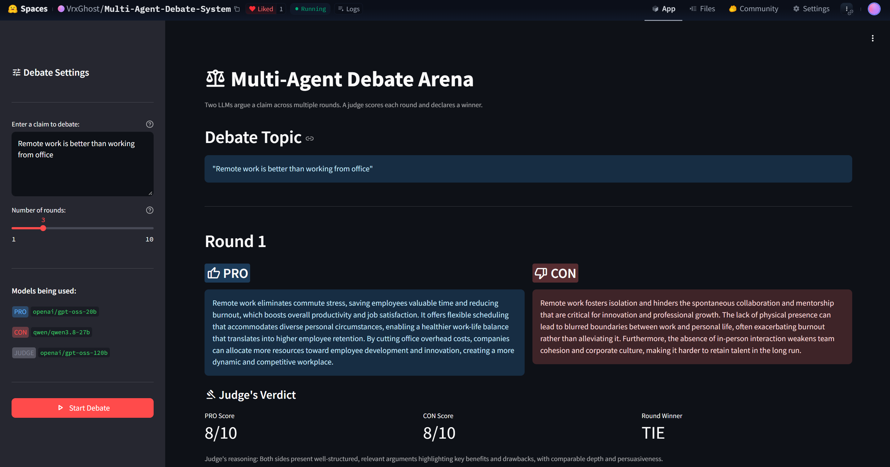
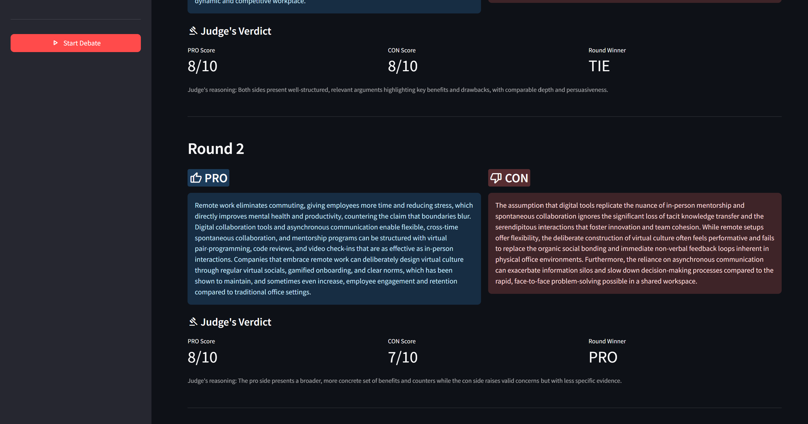
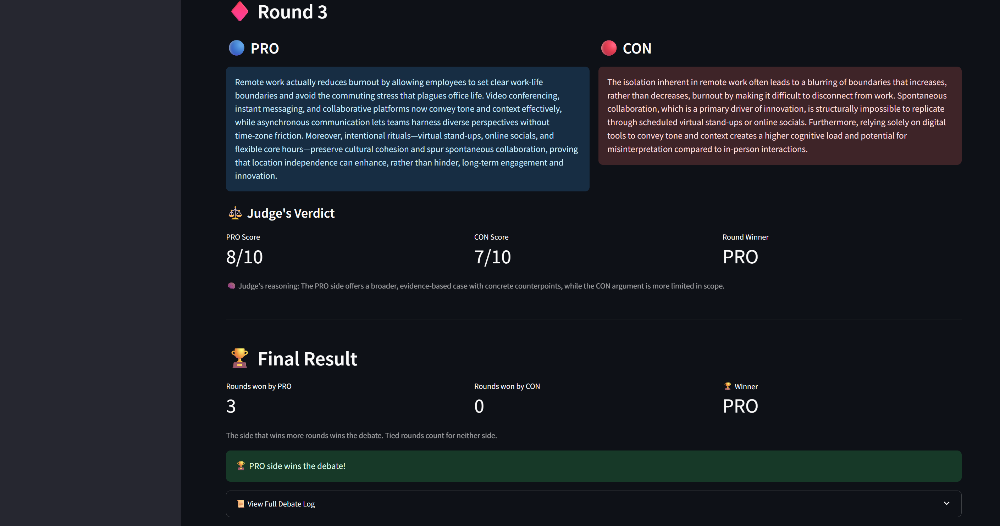

# ⚖️ Multi-Agent Debate System

Two LLM agents debate any claim over 1–10 rounds while a third LLM scores every round. Built with LangGraph and Streamlit on Groq, and deployed on Hugging Face Spaces.

[](https://huggingface.co/spaces/VrxGhost/Multi-Agent-Debate-System) [](https://python.org) [](https://langchain-ai.github.io/langgraph/) [](https://streamlit.io) [](https://console.groq.com)







**[Try the live demo](https://huggingface.co/spaces/VrxGhost/Multi-Agent-Debate-System).** The Space sleeps when idle, so the first load can take a minute.

## Features

- **Agent workflow as a state machine:** PRO, CON and the judge are LangGraph nodes that loop once per round and end in a verdict node.
- **Robust judge parsing:** scores are read with regular expressions (markdown, `8/10`, decimals, any letter case) and kept between 1 and 10. The higher score wins the round; the judge's own pick only breaks ties.
- **Live, persistent results:** each round appears as soon as it is judged, and the finished debate stays on screen across Streamlit reruns without new API calls.
- **Graceful failures:** a missing or invalid key, a rate limit, a retired model or an unreadable judge reply shows a clear message, and finished rounds stay visible.
- **Built for a public demo:** claims are capped at 600 characters, rounds at `MAX_ROUNDS`, and user text never enters a system prompt.
- **Pinned and auto-deployed:** dependencies are pinned, and a GitHub Actions workflow deploys every push to `main` to the Space.

## How it works


| Agent | Model (Groq) | Role |
| --- | --- | --- |
| PRO | `openai/gpt-oss-20b` | Argues for the claim and answers CON's last argument |
| CON | `qwen/qwen3.8-27b` | Argues against the claim and answers PRO's latest argument |
| Judge | `openai/gpt-oss-120b` | Scores both sides from 1 to 10 with a one-sentence reason |

The side that wins more rounds wins the debate; tied rounds count for neither side.

### System architecture


### App flow


## Quick start

Requires Python 3.10+ and a free API key from [console.groq.com](https://console.groq.com).

```bash
git clone https://github.com/VrxGhost/Multi-agent-Debate-System.git
cd Multi-agent-Debate-System
python -m venv .venv
source .venv/bin/activate        # Windows: .venv\Scripts\activate
pip install -r requirements.txt
cp .env.example .env             # Windows: copy .env.example .env
```

Replace the placeholder in `.env` with your key, run `streamlit run app.py` and open http://localhost:8501.

| Variable | Default | Purpose |
| --- | --- | --- |
| `GROQ_API_KEY` | required | Your Groq key: in `.env` locally, or as a Space secret on Hugging Face |
| `PRO_MODEL`, `CON_MODEL`, `JUDGE_MODEL` | see the table above | Swap any agent's model without a code change |
| `MAX_ROUNDS` | `10` | Highest value on the rounds slider |

## Design decisions

- **LangGraph instead of a plain loop.** The conditional edge, an explicit step limit (`3 × rounds + 5`) and state streaming come with the graph, and the flow stays easy to follow.
- **Scores decide the winner.** An LLM can name a winner that contradicts its own numbers, so the app takes the round winner from the scores.
- **Prompt-injection hygiene.** The claim and the arguments appear only in user messages (wrapped in `<< >>` for the debaters), and every system prompt tells the model to treat them as debate content, never as instructions.
- **Different model families.** CON runs on Qwen so the two debaters don't argue the same way, and the judge gets the largest model.

## Known limitations

- Each debater sees only the opponent's latest argument, not the whole debate.
- CON uses a Groq Preview model, which Groq can retire at short notice; set `CON_MODEL` to switch.
- PRO and the judge both run gpt-oss models, which may bias scores toward PRO.
- All visitors share one free-tier key, and a 10-round debate makes 30 API calls, so busy periods can hit rate limits.
- There are no automated tests yet.

## Project structure

```
├── app.py              # Streamlit UI: settings, live rounds, results, error messages
├── debate_graph.py     # DebateState, the LangGraph graph and the final verdict
├── pro_agent.py        # PRO debater
├── con_agent.py        # CON debater
├── judge_agent.py      # Judge and parse_verdict()
├── llms.py             # Model names (MODELS) and the Groq clients
├── requirements.txt    # Pinned dependencies
├── docs/diagrams/      # Architecture, debate-loop and app-flow diagrams
└── .github/workflows/  # Deploys main to the Hugging Face Space
```

## Author

**Arya Dutta**, B.Tech CSE student at IEM Kolkata

[](https://huggingface.co/VrxGhost) [](https://github.com/VrxGhost) [](https://www.linkedin.com/in/arya-dutta-9a4619317)
